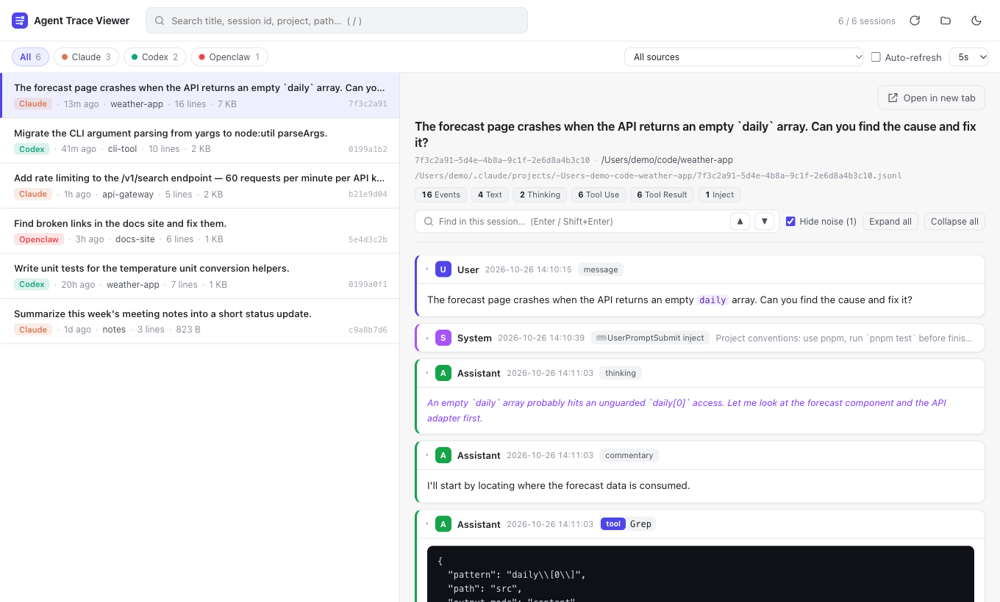
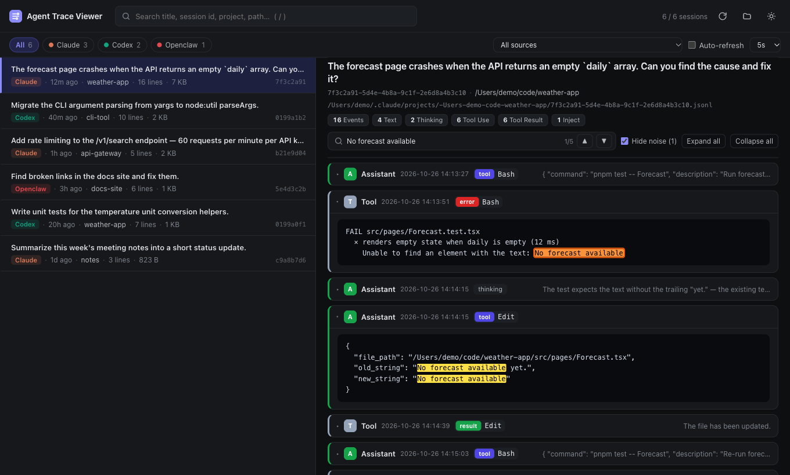

<div align="center">

# Agent Trace Viewer

**See exactly what your AI coding agent did.**
A local web UI for browsing the session traces that Claude Code, Codex, OpenClaw and Hermes leave on your disk.

[](https://www.npmjs.com/package/agent-trace-viewer)
[](https://nodejs.org)
[](LICENSE)


English · [简体中文](README.zh-CN.md)



</div>

## Why

Coding agents write a detailed log of every session — prompts, thinking, tool calls, tool output, hook injections, token usage — but as raw JSONL that's painful to read. **Agent Trace Viewer** turns those files into a searchable, collapsible timeline so you can:

- debug why an agent went off the rails, step by step;
- review what a long autonomous run actually changed;
- compare how different agents tackle the same task;
- find that one command or answer from last week.

Everything runs locally. No account, no upload, no telemetry.

## Quick start

```bash
npx agent-trace-viewer
```

Open **<http://localhost:8787>**. That's it — sessions from every supported agent on your machine show up automatically.

Prefer a global install?

```bash
npm install -g agent-trace-viewer
agent-trace-viewer        # or the short alias: atv
```

Requires **Node.js 18+** (Hermes sessions need Node 22.5+ for the built-in SQLite module).

## Features

| | |
|---|---|
| 🗂 **One list for every agent** | Claude Code, Codex, OpenClaw and Hermes sessions side by side, newest first. Each row shows the first real prompt as its title, the project folder, age and size. |
| 🔎 **Filter & search** | Agent pills with live counts, per-source filter, and multi-word search across title, session id, project and path. Optional auto-refresh while an agent is running. |
| 🧵 **Readable traces** | User / assistant / tool / system cards you can collapse one by one. Thinking, tool calls and their results (paired by id), errors, token usage and hook / context injections are all labelled. Low-signal system noise is hidden by default. |
| 🎯 **Find in session** | Highlights every match in a long trace and jumps between them with Enter / Shift+Enter — collapsed cards open automatically. |
| 🪪 **Accounts & projects** | Every row shows its project folder and, where the agent records one, the account that ran the session. Codex sessions carry per-session account IDs (mapped to your signed-in email or a custom label); Claude shows one shared machine identity; OpenClaw and Hermes have no account concept. Filter the list by project or account. |
| 🚚 **Batch migration with rollback** | Move selected sessions to another project folder, or reassign Codex sessions to another account, in one batch. Every target `.jsonl` is backed up automatically under `~/.agent-trace-viewer/backups` before changes, and a rollback restores the batch after a sha256 drift check. Claude account migration and Hermes (SQLite) are not supported. |
| ⌨️ **Keyboard friendly** | `/` focuses search, `j` / `k` (or ↑ / ↓) move between sessions. |
| 🌗 **Light & dark** | Follows your system theme; toggle any time. |
| 📁 **Any JSONL** | Point it at extra folders or single files. The format (Claude / Codex / OpenClaw) is detected from the content, not the path. |
| 🪶 **Tiny** | Zero runtime dependencies, ~40 KB package, read-only by default. |



## Supported agents

| Agent | Default location | Notes |
|---|---|---|
| [Claude Code](https://docs.anthropic.com/en/docs/claude-code) | `~/.claude/projects/**/*.jsonl` | thinking, tool use/results, hook & attachment injections, usage. One shared machine identity for every session; project migration supported, **account migration not supported** |
| [Codex CLI](https://github.com/openai/codex) | `~/.codex/sessions/**/rollout-*.jsonl` | reasoning summaries (encrypted reasoning is not visible), function calls, token totals. Per-session account IDs mapped to the signed-in email or a custom label; both project and account migration supported |
| [OpenClaw](https://github.com/openclaw/openclaw) | `~/.openclaw/agents/**/*.jsonl` | plain session logs and trajectory snapshots. No account concept; project migration supported |
| Hermes | `~/.hermes/state.db` | read from SQLite; includes compacted history and session totals. No account concept; **read-only, not migratable** |

Missing a format you use? [Open an issue](https://github.com/yunmij/agent-trace-viewer/issues) with a (redacted) sample.

## Usage

```
agent-trace-viewer [--port <n>] [--host <addr>] [--root <dir|file.jsonl> ...]

  -p, --port <n>       Port to listen on (default 8787, env PORT)
      --host <addr>    Address to bind (default 127.0.0.1, env HOST)
      --root <path>    Extra input: a directory or a single .jsonl file. Repeatable.
  -v, --version        Print version
  -h, --help           Show help
```

Examples:

```bash
atv --port 9000
atv --root ~/Downloads/shared-traces --root ./bug-report.jsonl
```

Extra sources can also be added and removed at runtime from the **Input sources** panel (folder icon, top right).

### Try it with demo data

Clone the repo and run:

```bash
npm install
npm run demo        # generates fictional sessions in .demo-home/ and serves only those
```

## Security & privacy

Agent transcripts often contain source code, file paths and occasionally secrets, so the defaults are strict:

- **Local only.** The server binds to `127.0.0.1` and rejects requests whose `Host` header isn't a loopback name, which blocks DNS-rebinding attacks.
- **Read-only by default.** Browsing never writes to your sessions: it only reads `.jsonl` files under the configured sources. The optional migration features are the only write operations, and they are limited to session `.jsonl` files. Every migration first copies the originals to `~/.agent-trace-viewer/backups`, and each batch can be rolled back after a sha256 drift check that refuses to restore modified files.
- **No cross-site changes.** Adding or removing sources, saving notes and running migrations require `POST` with `application/json`, so other websites can't trigger them.
- **Offline.** No network requests, no analytics.

`--host 0.0.0.0` makes **every local session readable from your network**. Only use it on networks you trust.

## HTTP API

| Endpoint | Description |
|---|---|
| `GET /api/sessions` | Rescan sources and list sessions |
| `GET /api/render?path=<path>` | Structured trace for one session |
| `GET /api/inputs` | List input sources |
| `POST /api/inputs` with `{"add": "<path>"}` or `{"remove": "<path>"}` | Add / remove an extra source |
| `GET /api/identity` | Local Claude / Codex identity and saved account labels |
| `POST /api/identity/notes` with `{"accountId": "<id>", "label": "<text>"}` | Save a custom label for a Codex account |
| `POST /api/migrate` with `{"type": "project"\|"account", "value": "<path|accountId>", "userId": "<id>", "targets": ["<path>", ...]}` | Batch project or account migration; automatic backup per target |
| `GET /api/migrations?withOps=1&rollbacks=1` | List migration batches, newest first; `withOps=1` includes per-op details, `rollbacks=1` also lists rollback safety batches |
| `POST /api/migrations/rollback` with `{"id": "<batchId>"}` | Roll back a batch after a sha256 drift check |
| `GET /session_trace.html?path=<path>` | Full-page view of a single trace |

## Development

```bash
git clone https://github.com/yunmij/agent-trace-viewer.git
cd agent-trace-viewer
npm install
npm start            # runs the TypeScript sources directly (Node ≥ 22.18 type stripping)
npm run typecheck
npm run build        # tsc → dist/ (this is what gets published; runs on Node ≥ 18)
```

The frontend in `web/` is plain browser JS/CSS served as-is — edit and refresh, no build step.

```
bin/agent-trace-viewer.ts   CLI entry
src/config.ts               sources, CLI args, help
src/scan.ts                 discover sessions + metadata (title / cwd / format)
src/parse-*.ts              per-agent parsers → one trace model (src/types.ts)
src/render.ts               /api/render: path checks, cache, format dispatch
src/server.ts               HTTP routes, static files, host check
src/pages.ts                HTML shells
web/                        list.js · trace.js · trace.css
scripts/make-demo.mjs       fictional demo sessions
```

Contributions are welcome — please run `npm run typecheck` before opening a PR.

## License

[MIT](LICENSE)
